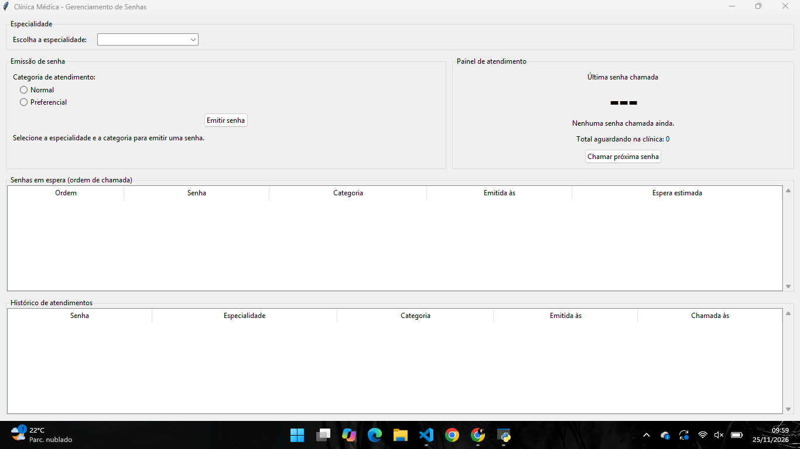
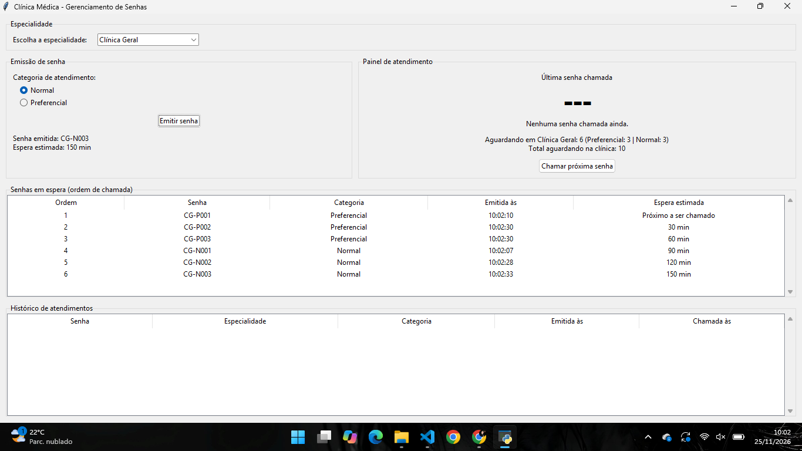
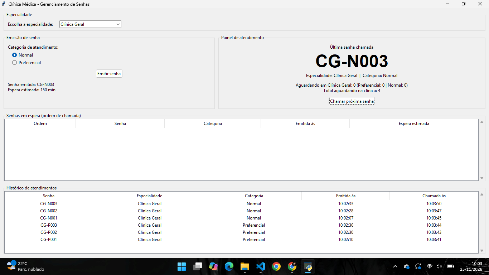
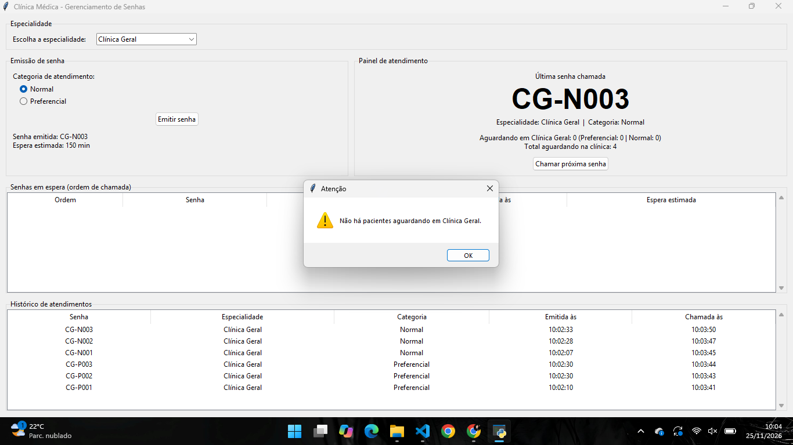
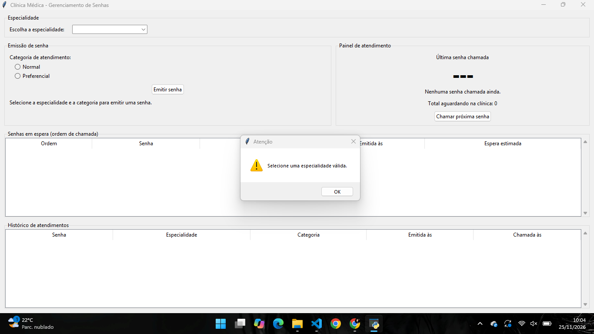
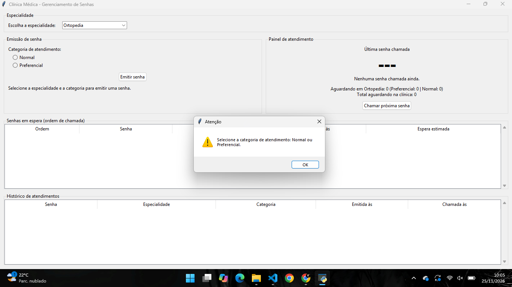

# Sistema de Gerenciamento de Senhas para Clínica Médica

Projeto da parte prática da prova regimental A1 — Estrutura de Dados II  
Centro Universitário UDF — Ciência da Computação — 4º semestre

## Integrante

- Kevyn Cardoso Diniz — matrícula: 04395274-7

## Objetivo

Informatizar o gerenciamento de senhas de atendimento de uma clínica médica com três especialidades (Clínica Geral, Cardiologia e Ortopedia), organizando as filas, reduzindo o tempo de espera e garantindo atendimento prioritário, aplicando filas FIFO e filas de prioridade, com interface gráfica em Tkinter.

## Funcionalidades

- Três especialidades: Clínica Geral (CG), Cardiologia (CA) e Ortopedia (OR).
- Emissão de senhas Normal e Preferencial, identificadas por especialidade, categoria e número (exemplos: CG-N001, CG-P001, CA-N001).
- Filas independentes por especialidade e categoria (seis filas), cada uma respeitando a ordem de chegada.
- Chamada da próxima senha de uma especialidade, com prioridade para os preferenciais.
- Registro de todas as senhas chamadas no histórico de atendimentos.
- Painel de atendimento: última senha chamada, especialidade, categoria, quantidade de pacientes aguardando e relação das senhas em espera.
- Tempo estimado de espera de cada senha (30 minutos por atendimento).
- Tratamento de exceções: fila vazia, ausência de pacientes, entradas inválidas e operações incompatíveis com o estado das filas.

## Estruturas de dados utilizadas

| Estrutura | Onde é usada | Por quê |
|---|---|---|
| Lista encadeada (classe No) | Base da FilaFIFO | Permite inserir no fim e remover do início em tempo constante, O(1) |
| FilaFIFO | Uma fila por categoria em cada especialidade | Garante a ordem de chegada (primeiro a entrar, primeiro a sair) |
| FilaPrioridade | Uma por especialidade; agrupa a fila P e a fila N | Aplica a regra de prioridade entre as categorias |
| Dicionários | Especialidades, categorias, filas por especialidade e contadores de numeração | Acesso direto por chave |
| Lista | Histórico de atendimentos | Registra as senhas na ordem em que foram chamadas |

## Regra de prioridade adotada

1. Cada especialidade possui duas filas FIFO independentes: Preferencial (P) e Normal (N).
2. Ao chamar a próxima senha de uma especialidade, o sistema retira da fila Preferencial. Somente quando ela está vazia retira da fila Normal (prioridade estrita).
3. Dentro de cada categoria vale a ordem de chegada (FIFO).
4. As especialidades são independentes: a prioridade só compete dentro da mesma especialidade.

Exemplo: em Clínica Geral chegam, nesta ordem, CG-N001, CG-N002 e CG-P001. A ordem de chamada será CG-P001, CG-N001, CG-N002.

Limitação conhecida: com a prioridade estrita, uma chegada contínua de preferenciais pode atrasar os normais.

## Tempo estimado de espera

Hipóteses adotadas:

- H1: cada atendimento dura em média 30 minutos.
- H2: há um profissional por especialidade, atendendo um paciente por vez.
- H3: a espera de uma senha é o número de pacientes à frente dela na ordem de chamada multiplicado por 30 minutos.
- H4: a estimativa considera a situação atual da fila; se chegar um preferencial depois, a espera dos normais aumenta e a tela recalcula.

Exemplo: com CG-P001, CG-N001 e CG-N002 aguardando, as esperas são 0 (próximo a ser chamado), 30 e 60 minutos.

## Tratamento de exceções

- FilaVaziaError: tentativa de remover ou consultar elemento de fila vazia.
- SemPacientesError: chamada em especialidade sem pacientes aguardando.
- EntradaInvalidaError: especialidade ou categoria não informadas ou inválidas.
- OperacaoInvalidaError: operação incompatível (por exemplo, passar de 999 senhas, ou estimar espera de senha que já saiu da fila).

A interface captura esses erros e mostra um aviso, sem encerrar o programa.

## Estrutura do projeto

```text
clinica_senhas/
├── main.py
├── README.md
├── requirements.txt
├── clinica/
│   ├── constantes.py
│   ├── excecoes.py
│   ├── senha.py
│   ├── fila.py
│   ├── gerenciador.py
│   └── interface.py
├── testes/
│   └── test_gerenciador.py
└── imagens/
```

## Instalação e execução

Requisitos: Python 3.10 ou superior com Tkinter (já incluído na instalação padrão do Python; no Ubuntu, instale com `sudo apt install python3-tk`). Não há bibliotecas externas.

```text
git clone https://github.com/kevyndiniz-git/sistema-senhas-clinica.git
cd sistema-senhas-clinica
python main.py
```

Testes automáticos:

```text
python -m unittest discover -s testes -v
```

## Imagens da interface













## Vídeo demonstrativo

[Link do vídeo]

## Observações

Os dados ficam apenas em memória; ao fechar o programa, as filas são reiniciadas.

Conforme as orientações da atividade, o uso de ferramentas de inteligência artificial como apoio ao desenvolvimento era permitido. Utilizei a IA como apoio na elaboração do projeto, e compreendi, validei e sou capaz de explicar as soluções implementadas.